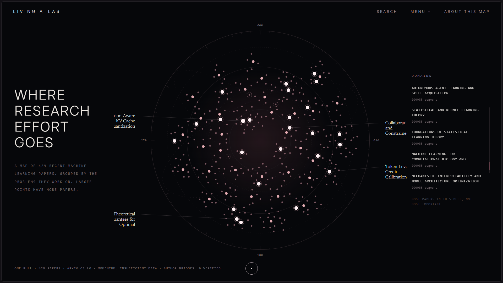
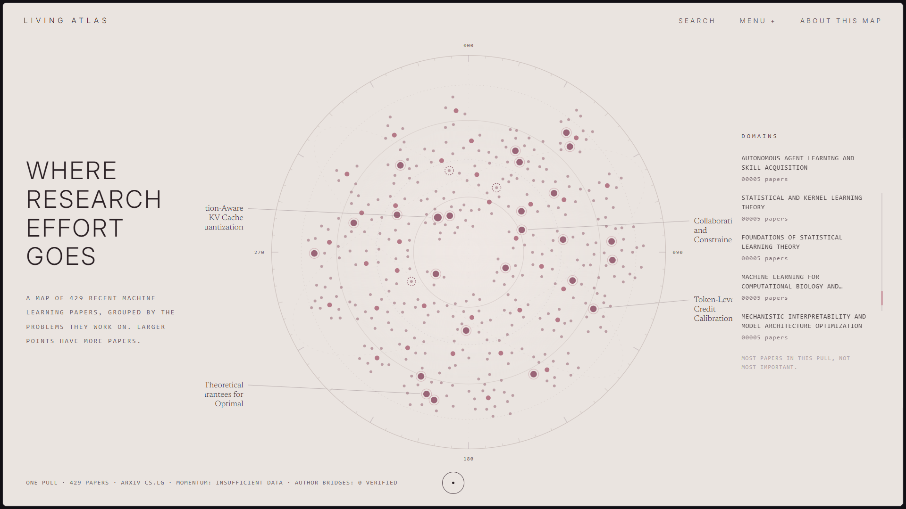
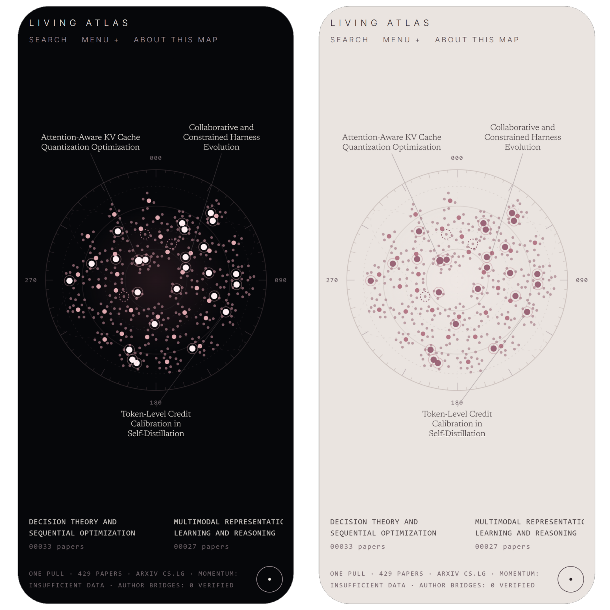

<h1 align="center">Living Atlas</h1>

<p align="center"><b>A map of where research effort sits in machine learning.</b><br>
One week of arXiv cs.LG: 429 papers, 403 topics, 41 domains.</p>

<p align="center">
  <a href="https://kritantdev.github.io/living-atlas/"><b>Open the live map &rarr;</b></a>
</p>

<p align="center">
  
  
  
  
</p>

<div align="center">
<table>
  <tr>
    <td width="50%"></td>
    <td width="50%"></td>
  </tr>
  <tr>
    <td align="center"><sub>Dark</sub></td>
    <td align="center"><sub>Light</sub></td>
  </tr>
</table>
</div>

<p align="center">
  <a href="#overview">Overview</a> &middot;
  <a href="#reading-the-map">Reading the map</a> &middot;
  <a href="#findings">Findings</a> &middot;
  <a href="#method">Method</a> &middot;
  <a href="#limitations">Limitations</a> &middot;
  <a href="#data">Data</a> &middot;
  <a href="#citation">Citation</a> &middot;
  <a href="#credits-and-licence">Licence</a>
</p>

---

## Overview

> Living Atlas turns a week of machine-learning papers into a browsable map of **research effort**: which specific problems attract papers and authors, and which look significant but have little visible work behind them. Each point is a topic, a specific problem that one or more papers address. It shows effort at one moment, not trends, and draws a link between fields only where it survives verification, so there are none in this pull.

| Papers mapped | Topics | Recurring topics | Domains | Under-explored candidates | Verified collisions |
| :---: | :---: | :---: | :---: | :---: | :---: |
| 429 of 553 | 403 | 25 | 41 | 3 | 0 |

*Papers submitted 30 July to 5 August 2026. "Recurring" means two or more papers in one topic. The 124 papers (22%) not mapped fell outside every domain in the clustering step.*

## Reading the map

- **A point** is a topic: a specific problem one or more papers address.
- **Size** follows paper count. It measures volume, not importance.
- **A bright halo** marks a topic with two or more papers (25 of 403).
- **A dashed ring** marks one of three *under-explored candidates*: topics that look significant but have little visible work in this pull. Each one states what would prove it wrong.
- **Domains** group related topics. Where a domain sits on the map carries no meaning.
- **Menu → Most concentrated topics** lists the five topics with the most papers (two-paper minimum, ties broken by distinct authors).

<p align="center">
  
</p>

## Findings

**Under-explored candidates.** Three topics were ranked against their peers by a language model, then checked by hand against the papers' abstracts. "Under-explored" means little visible work *in this pull*. It does not mean neglected in the field.

| Rank | Topic (model-written label) | Paper |
| :---: | --- | --- |
| 1 | Irreducible per-round loss from representation aliasing | [2608.02267v1](https://arxiv.org/abs/2608.02267v1) |
| 2 | Silent measurement failures in AI | [2608.02786v1](https://arxiv.org/abs/2608.02786v1) |
| 3 | Black-box LLM response corruption identifiability | [2608.04552v1](https://arxiv.org/abs/2608.04552v1) |

**Conservative by design.** The map only shows what the data supports.

- **Trends need more than one snapshot.** This map shows where effort sits in a single week. Only 25 of 403 topics have more than one paper, so a week alone is too little to say whether any topic is growing or fading. Trends need data from more than one point in time.
- **Links between fields are drawn only when they hold up.** Shared authors were tested as a sign of fields converging, across all 820 domain pairs. Three pairs passed the statistical threshold, and on reading their titles, abstracts and co-authors, none held up as a real link. The map shows no connecting lines rather than lines that are not real.

## Method

1. **Ingest** one pull from the arXiv API (cs.LG): 553 papers.
2. **Embed** title and abstract locally with open-weight models, and cluster the embeddings into 41 domains. Domain names were written by a language model; one was corrected by hand.
3. **Label** each paper's specific problem with a language model, from its abstract.
4. **Group** papers within each domain into topics. For topics with more than one paper, a second model audited whether each paper belongs.
5. **Count** papers and distinct authors per topic.
6. **Rate** topics for under-exploration with a model, then verify the top three by hand against abstracts.
7. **Test** domain pairs for shared authors, then read the surviving pairs by hand.

## Limitations

- **Checked by hand.** Across multiple rounds of data collection, more than 13 domains were manually evaluated against their paper abstracts. However, because domain IDs change with each map rebuild, only 4 of those manually labelled domains could be matched to the current grouping. Across these 4 of 41 domains, **5 of 7 comparable groups agreed** with the manual assessment.
This is a limited validation sample, not a comprehensive accuracy measure. Some topics may still be mislabelled or incorrectly merged. **When a domain label conflicts with its papers’ abstracts, the abstracts take precedence.**
- **Model-written text.** Labels, names and descriptions in `data/` were produced by language models. Single-paper topics were not audited.
- **Papers that don't fit are left out, not forced in.** 124 of 553 pulled papers (22%) did not fall into any domain's group of related papers, so they are not shown, rather than being pushed into a domain that does not fit. These tend to be one-off or unusual topics, so the map is better at showing where effort concentrates than at showing the long tail.
- **One snapshot.** A topic with few papers here has few in this pull, not necessarily in the field. A mature subject can look sparse in a single week.
- **Author matching uses name strings,** with no identity disambiguation, so common names can create false links.

## Data

Plain JSON in [`data/`](data/), loaded directly by the page.

| File | Contents |
| --- | --- |
| `nodes.json` | 403 topics |
| `clusters.json` | 41 domains with names and sizes |
| `edges.json` | The 3 domain pairs that cleared the statistical floor, all judged by hand to be name collisions. The page draws no lines. |

<details>
<summary><b>Topic fields</b></summary>

| Field | Meaning |
| --- | --- |
| `id`, `name` | Topic label (model-written) |
| `description` | One-sentence description (model-written) |
| `domain_id` | The domain the topic belongs to |
| `paper_count` | Papers in the topic |
| `unique_author_count` | Distinct authors across those papers |
| `concentration_score` | Paper count plus distinct authors (stored, not used to rank) |
| `is_recurring` | `true` when `paper_count >= 2` |
| `arxiv_ids` | The papers, so you can find them on arXiv |
| `verification_status` | How the label was decided: audited, audited outlier, single paper, audit failed, or hand-corrected |
| `gap_flag` | `is_gap`, `rank`, `short_label` and `falsifiability_note` for the three candidates |

</details>

```python
import json

nodes = json.load(open("data/nodes.json", encoding="utf-8"))
top = sorted((n for n in nodes if n["is_recurring"]),
             key=lambda n: (-n["paper_count"], -n["unique_author_count"]))[:5]
for n in top:
    print(n["paper_count"], n["unique_author_count"], n["name"])
```

## Repository

```
.
├── index.html          the whole site, one file
├── data/               nodes.json, clusters.json, edges.json (CC BY-SA 4.0)
├── fonts/              Inter and Newsreader, bundled (SIL OFL 1.1)
├── screenshots/
├── update_pull.py      updates the page's paper count and dates
├── export_site.py      generates data/ from the unpublished pipeline
├── CITATION.cff
├── DATA_LICENSE.md
└── LICENSE             AGPL-3.0-only
```

`export_site.py` needs pipeline files that are not published, so it will not run from a fresh clone. To view the site locally, run `python -m http.server 8080` and open `http://localhost:8080/`. Opening `index.html` directly will not load the data.

## Citation

If you use the map or its data, please cite it. GitHub's "Cite this repository" button reads [`CITATION.cff`](CITATION.cff).

```bibtex
@dataset{bhatia2026livingatlas,
  author = {Bhatia, Kritant},
  title  = {Living Atlas: a map of research effort in machine learning (snapshot v0.1.0)},
  year   = {2026},
  url    = {https://github.com/kritantdev/living-atlas}
}
```

## Feedback

Found a mislabelled topic, confusing wording, or something wrong? [Open an issue](https://github.com/kritantdev/living-atlas/issues/new/choose). There is a template for mislabelled topics.

## Credits and licence

Thank you to arXiv for use of its open access interoperability. This is an independent project; it was not reviewed or approved by arXiv and does not reflect its policies. Papers belong to their authors.

**Models used.** The text in `data/` was written by language models: Mistral AI's Ministral models (via the Mistral API) for problem labels, topic audits and candidate ratings; Google Gemini 3.1 Flash-Lite (via the Gemini API) for domain names and descriptions; and, for some early labels, Meta Llama 3.1 8B Instruct (via Groq). Embeddings were computed locally with open-weight models. Meta, Llama, Mistral, Google and Gemini are trademarks of their owners. This project is independent and is not endorsed by them.

- **Code:** GNU Affero General Public License v3.0 only (`AGPL-3.0-only`, see [`LICENSE`](LICENSE)). Copyright (C) 2026 Kritant Bhatia. If you modify this project and share it, or run a modified version as a public service, you must make your source available under the same licence.
- **Data in `data/`:** CC BY-SA 4.0 (see [`DATA_LICENSE.md`](DATA_LICENSE.md)). Please credit "Living Atlas, Kritant Bhatia (2026)" if you reuse it.
- **Fonts in `fonts/`:** Inter and Newsreader, SIL Open Font License 1.1 (see `fonts/`).
- **Other licensing:** for use that doesn't fit these terms, open an issue to ask about a separate licence.

Labels were written by language models and are provided as-is, without warranty.
